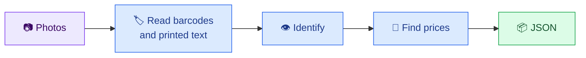
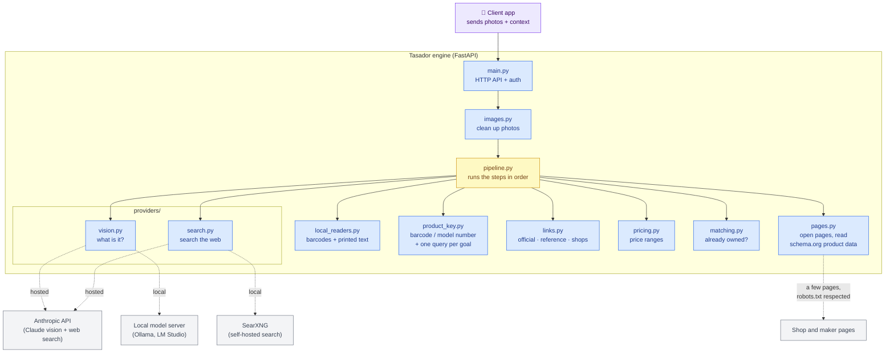
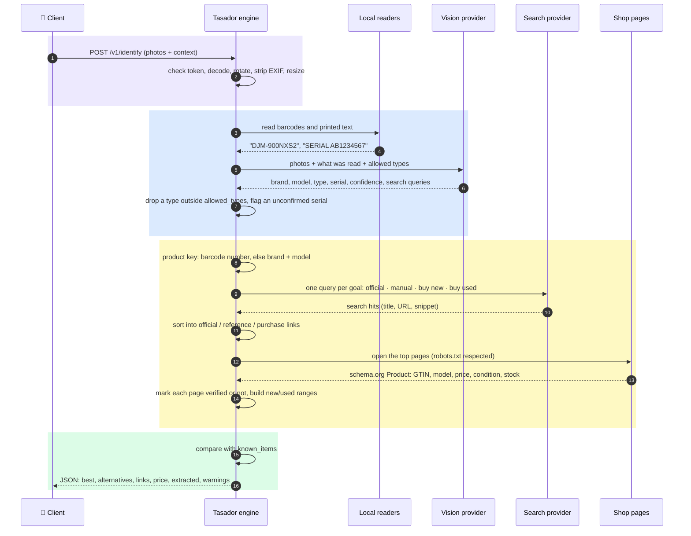
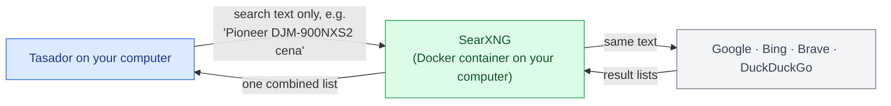
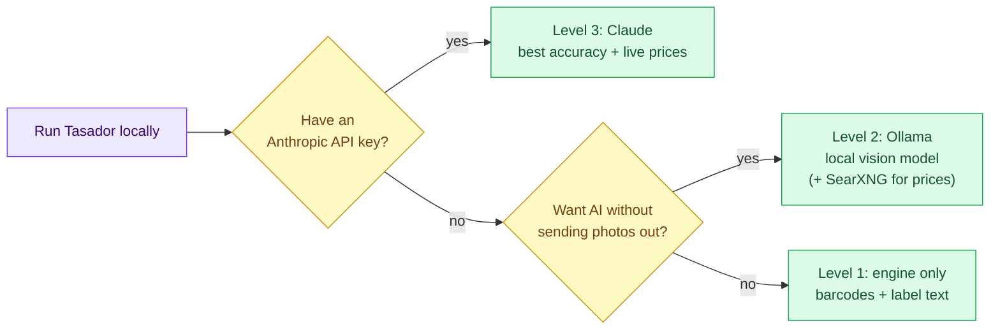
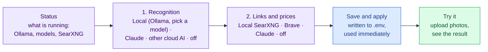
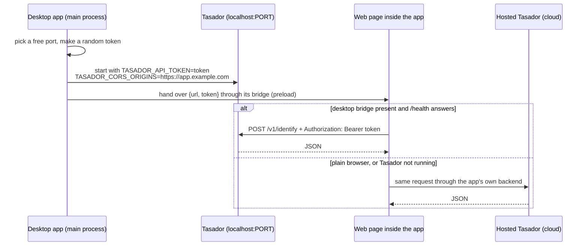
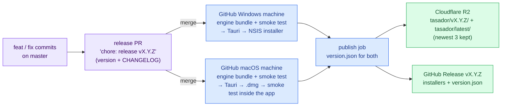

# Tasador 🔎

> *"Show me what you've got, I'll tell you what it is and what it's worth."*
> **Photos of a physical item in, JSON out: what it is and what it costs, with sources.**
> Python 3.11+ / FastAPI / zxing-cpp + RapidOCR / Claude or any local vision model / Claude web search or SearXNG

[](LICENSE)
[](#run-it-standalone-on-your-computer)
[](docs/ARCHITECTURE.md)
[](#-requirements)

*Tasador* is Spanish for appraiser. Point a phone at a mixer, a projector, a chair or a drill, send the photos, and get back the brand, model, type, serial number, and new and used price ranges with the shop pages they came from. It is a standalone service: it stores nothing and knows nothing about the app calling it.

**What you need** ([full requirements](#-requirements)):

| To run | You need |
| :--- | :--- |
| **The engine** (barcodes + label text) | Python 3.11+, ~350 MB disk, ~450 MB RAM, Windows / macOS / Linux |
| **+ local AI recognition** | [Ollama](https://ollama.com) with a vision model: `qwen2.5vl:7b` (16 GB RAM or an 8 GB GPU) or `qwen3.5:2b` (a 4 GB GPU is enough) |
| **+ local links and prices** | [Docker Desktop](https://www.docker.com/products/docker-desktop/) to run SearXNG |
| **or hosted AI instead** | An API key from Anthropic, OpenAI, Google Gemini, OpenRouter, Groq, Mistral, Together or xAI (paid per request) |

---

## 🧠 The 10-second mental model

```
┌──────────────────────────────────────────────────────────────────────────────┐
│ 1. PHOTOS IN     ──> 📷 1-8 photos (upload or allowed URLs) + optional context │
│ 2. READ LOCALLY  ──> 🏷️  barcodes (zxing-cpp) + nameplate text (RapidOCR)     │
│ 3. IDENTIFY      ──> 👁️  Claude or a local vision model, schema-constrained   │
│ 4. PRICE         ──> 🛒 web search → listings → new / used ranges + sources   │
│ 5. JSON OUT      ──> 📦 best guess, alternatives, prices, duplicates, warnings│
└──────────────────────────────────────────────────────────────────────────────┘
```



🟪 input · 🟦 Tasador · 🟩 output. The full picture is in [docs/ARCHITECTURE.md](docs/ARCHITECTURE.md).

---

## 🏗️ How it works

### The parts

Tasador is one Python service, the **engine** (`services/tasador-engine`). Inside it, each step of the job is a small module, and the two steps that need outside help (recognising the item, finding prices) go through **providers**: swappable connectors to a model or a search engine. You choose providers with environment variables. The code that calls them never changes.



🟪 caller · 🟦 Tasador code · 🟨 the pipeline that decides the order · ⬜ outside services (dotted lines: only one of each pair is used, depending on your settings)

### One request, step by step



| # | Step | What happens | Why it is done this way |
| :--- | :--- | :--- | :--- |
| 1 | **Clean up the photos** | Each photo is rotated upright, re-saved as a JPEG of at most 1568 px, and loses its metadata. | Phones store GPS and device data in photos; this removes it. Smaller images make model calls faster and cheaper. |
| 2 | **Read locally** | zxing-cpp reads barcodes; RapidOCR reads printed text such as a nameplate. No model, no network. | A label is the most reliable source for an exact model number or serial number, and reading it costs nothing. |
| 3 | **Identify** | The photos and the text read in step 2 go to a vision model, which answers in a fixed JSON shape. | Giving the model the label text stops it guessing model numbers from the shape. The fixed shape means the answer can always be parsed. |
| 4 | **Check the answer** | A `type` outside your `allowed_types` is dropped. A serial number the text reader never saw is marked `serial:unconfirmed`. | Models sometimes invent details. Only what can be checked is trusted. |
| 5 | **Pick the product key** | The strongest identifier wins: a barcode number (GTIN, checksum-validated), else brand + model number, else the descriptive name. | Price comparison sites match offers the same way: by identifier, not by picture. |
| 6 | **Search the web, one query per goal** | Four searches in the caller's language: the maker's page, manual/specs, buy new, buy used. | One mixed query returns mostly shops; separate goals bring back official pages and manuals too. |
| 7 | **Sort the results** | Each hit becomes an **official** link (domain carries the brand), a **reference** link (manual, specs, review, encyclopedia) or a **purchase** link (known shop or marketplace, a shop-like address, or a page showing a price). Hits that never mention the model are dropped ("DJM 900 Nexus 2" still counts for DJM-900NXS2, "DJM-A9" does not), tracking parameters are removed, and each page is listed once. A shop's **search-results page** (OLX `/q-…`, Allegro `/listing`, eBay `/sch/`, Amazon `/s`) stays as a "browse offers" link with `page: "search"`, but its prices are ignored: they belong to many different items. | The client gets ready-made groups: "read about it" and "buy it", without other models or duplicates. |
| 8 | **Open the top pages and check them** | Up to 8 pages are fetched: single offers first, plus the maker's page. Their schema.org `Product`/`Offer` data gives the exact price, currency, condition and stock, and the page's own barcode / model number. Each link is marked `verified: gtin`, `model`, `unconfirmed` or `unchecked`. When the photo had no barcode, the barcode number that the confirmed pages agree on fills `best.gtin` (`evidence: gtin:from-shop-page`). | Snippets are often stale or about a different variant. Shops publish this data for Google Shopping, so reading it needs no AI. Some sites refuse automated visitors or forbid it in robots.txt; those links stay `unchecked`. |
| 9 | **Build price ranges** | New and used ranges from verified pages only (`price.verified_only: true`). If none could be verified, snippet prices are used and a warning says so. Only your currency counts, never converted; outliers are dropped. | A number a person can trust, with every source one click away. |
| 10 | **Find duplicates** | The result is compared with the `known_items` you sent. | Lets the client say "you already own 3 of these" instead of creating a duplicate. |
| 11 | **Answer** | One JSON response, with `warnings` for any step that was skipped or failed. | A failed search still returns the identification. Only bad input gives an HTTP error. |

### One photo or several angles

Send **1 to 8 photos of the same item**: for example the front, the back and a close-up of the nameplate. They are treated as one item:

- **Barcodes and printed text are read from every photo** and merged. A serial number on the back counts for the whole item.
- **The model is told the photos are angles of one item**, and each line of text is tagged with the photo it came from ("photo 3: SERIAL AB1234567").
- **Local models get at most 4 photos** (`TASADOR_VISION_MAX_IMAGES`), because each photo costs GPU memory and time. Tasador sends the first photo (usually the overall view), then the ones with a barcode, then the ones with the most text, and `warnings` says which ones the model saw. Claude gets all of them.
- **Photos of different items** are not split into several results: the model describes the most prominent item and `warnings` says the photos looked like different items. Send one request per item.

One good photo of a readable label usually beats several blurry overall shots.

How this design was chosen, and how Google Lens, Amazon, eBay and price comparison sites do it: [docs/RESEARCH.md](docs/RESEARCH.md).

### Hosted or local: same engine, different providers

| | Hosted (e.g. Render) | Local (your computer) | Minimal (no providers) |
| :--- | :--- | :--- | :--- |
| Vision | Claude or any other provider ([list](#-providers-claude-or-any-other)) | Ollama / LM Studio (e.g. Qwen2.5-VL) | none |
| Web search (links + prices) | Brave Search or Claude web search | SearXNG | none |
| Barcodes + printed text | yes (OCR needs ~450 MB RAM) | yes | yes |
| Where photos go | Anthropic API | nowhere: they stay on the machine | nowhere |
| Accuracy | best | good for branded items with a visible label | label text and barcodes only |

`GET /v1/capabilities` reports which column a running copy is in, so a client can try a local copy first and fall back to a hosted one.

---

## 🔌 Providers: Claude or any other

Tasador is not tied to one AI company. The two steps that use an outside service each take a provider:

| Step | Provider (`TASADOR_..._PROVIDER`) | What to set |
| :--- | :--- | :--- |
| **Vision** (what is it?) | `anthropic` | `ANTHROPIC_API_KEY` (model defaults to `claude-opus-5-5`) |
| | `openai`, `gemini`, `openrouter`, `groq`, `mistral`, `together`, `xai` | `TASADOR_VISION_API_KEY` + `TASADOR_VISION_MODEL` (a model of theirs that reads images) |
| | `ollama`, `lmstudio` | `TASADOR_VISION_MODEL` (Ollama defaults to `qwen2.5vl:7b`). No key, runs on your computer |
| | `openai-compatible` | `TASADOR_VISION_BASE_URL` (+ key and model): any other server with an OpenAI-style `/chat/completions` API, such as vLLM or a company gateway |
| **Web search** (links, prices) | `searxng` | `TASADOR_SEARXNG_URL`. No key, runs in Docker |
| | `brave` | `TASADOR_SEARCH_API_KEY` from the Brave Search API |
| | `anthropic` | `ANTHROPIC_API_KEY` (Claude's web search tool) |

Every provider except `anthropic` speaks the same OpenAI-style API, so the named ones are presets that only fill in the address; adding another is one line in `config.py`. Mix them freely, for example Gemini for vision and SearXNG for search. Local servers automatically get "thinking" turned off and a 4-photo limit; cloud APIs get neither.

## 🔍 What is "local search" (SearXNG)?

To find official pages, manuals, shops and prices, Tasador has to search the web. **SearXNG** is a free, open-source *meta-search engine*: it has no index of its own, but sends your search to Google, Bing, Brave, DuckDuckGo and others, and combines their results into one list.



🟦 Tasador · 🟩 runs on your computer · ⬜ outside services

"Local" means **SearXNG runs on your computer**, inside Docker. That is why:

- **No account and no API key:** it uses the search engines' public pages, as a browser would.
- **Private:** only the search text leaves your computer. Your photos, and which items you own, never do.
- **Free:** no per-search cost. The trade-off is that it needs Docker Desktop, and some engines occasionally answer slowly or ask for a CAPTCHA; SearXNG then uses the others.

Without Docker, choose **Brave Search** (an API key with a free tier) or **Claude web search** in the settings page.

## 📋 Requirements

### Always needed

| Requirement | Details |
| :--- | :--- |
| **Operating system** | Windows 10/11, macOS or Linux, 64-bit. `Tasador.bat` is for Windows; elsewhere use the terminal commands below |
| **Python 3.11 or newer** | [python.org](https://www.python.org/downloads/). On Windows, tick *Add python.exe to PATH* when installing |
| **Disk** | ~350 MB for the engine and its libraries (most of it is OpenCV and ONNX Runtime for text reading) |
| **Memory** | ~130 MB for the engine alone; peaks around ~450 MB while reading text from a photo |
| **Internet** | Only for the first install, and later for price search and Claude. Barcodes, text reading and Ollama work offline |
| **Free port** | `8000` (change `PORT` in `Tasador.bat` or `--port` if it is taken) |

Optional but recommended: [**uv**](https://docs.astral.sh/uv/), which makes the install much faster. `Tasador.bat` uses it when it finds it and falls back to `pip` otherwise.

### Extra, depending on the level you choose

| For | You need | Hardware | Cost |
| :--- | :--- | :--- | :--- |
| **Local AI recognition** (level 2) | [Ollama](https://ollama.com) + `ollama pull qwen2.5vl:7b` (~6 GB download), port `11434` | 16 GB RAM, or a GPU with 8 GB+ VRAM for answers in seconds. On a CPU only it works but can take a minute per item. On smaller machines (e.g. a 4 GB GPU) use `qwen3.5:2b` (~2.7 GB): tested on a GTX 1650 laptop, about 25 s per item. Set `TASADOR_VISION_MODEL` to the model you pulled | free |
| **Local price search** (level 2b) | [Docker Desktop](https://www.docker.com/products/docker-desktop/) to run SearXNG, port `8888` | ~200 MB RAM | free |
| **Claude** (level 3) | An [Anthropic API key](https://console.anthropic.com/) | nothing extra: the work happens at Anthropic | paid per request, see [pricing](https://www.anthropic.com/pricing) |
| **Everything in Docker** | Docker Desktop (or Docker Engine + Compose v2) | the sum of the rows above | free |
| **Hosting on Render** | A [Render](https://render.com) account + an Anthropic API key | free plan (512 MB) is enough: it runs without text reading | Render free plan + Anthropic usage |

To check what you have:

```bash
python --version          # 3.11 or newer
uv --version              # optional
ollama list               # level 2: the model should be listed
docker compose version    # only for SearXNG / Docker
```

---

## Run it standalone on your computer

Tasador needs nothing else to run: no PlaatoOS, no cloud account, no database. You pick how smart it is by what you connect to it.



See [Requirements](#-requirements) for what each option needs.

### Windows: double-click

Double-click **[`Tasador.bat`](Tasador.bat)**. It sets everything up by itself:

| Step | What it does |
| :--- | :--- |
| 1. Install | First run: creates `services/tasador-engine/.venv` and installs the engine (a few minutes, mostly the text-reading model). Later runs repair it if a package is missing |
| 2. Settings | Reads a `.env` next to it, if you made one from [`.env.example`](.env.example). Anything set there wins over the automatic choices below |
| 3. Recognition | If [Ollama](https://ollama.com) is running, uses it and picks an installed model that can read images (`qwen2.5vl`, `qwen3.5`, `gemma3`, `llava`...). If none is installed it tells you what to pull |
| 4. Links and prices | If Docker Desktop is running, starts SearXNG in Docker (it keeps running after you close the window: `docker compose stop searxng` stops it) |
| 5. Start | Starts the engine on `http://localhost:8000`, listening on this computer only, and opens the **settings page** `http://localhost:8000/` |

Close the window to stop the engine. Missing Ollama or Docker is not an error: that part is simply off, and the window says so.

### The settings page

`Tasador.bat` opens **http://localhost:8000/**, a small page to change everything without editing files:



- **Models:** the Ollama dropdown lists only installed models that can read images, best first. If there is none, the page says which one to pull.
- **Keys:** a saved key is never shown again, only "saved ✓". Leave the field empty to keep it.
- **Saving:** settings that cannot work (for example a cloud provider without a model name) are refused before anything is saved.
- **Try it:** shows the identification, prices, official pages, manuals and shops as readable cards, with the raw JSON underneath.

Because the page can change where photos are sent, it is off unless the launcher turns it on (`TASADOR_SETTINGS_UI=1`). It answers only this computer: the connection must come from `127.0.0.1` and the `Host` header must be `localhost`. That `Host` check stops "DNS rebinding", where a website points its own domain at your computer. Saving also needs a random key that only the page knows. Never enable it on a server.

### Typical setups

| Setup | What to set (in the settings page or `.env`) | Good for |
| :--- | :--- | :--- |
| **Fully local, free** | nothing: just have Ollama and Docker Desktop running | privacy, no costs |
| **Local, no Docker** | search: Brave + its API key | computers without Docker |
| **Best quality** | recognition and search: Claude + `ANTHROPIC_API_KEY` | items without a readable label |
| **Mixed** | recognition: Gemini (or another cloud AI) + key + model; search: local SearXNG | a cheaper cloud model with free search |
| **Server for an app** (e.g. Render) | `ANTHROPIC_API_KEY`, `TASADOR_API_TOKEN`, `TASADOR_ALLOWED_IMAGE_HOSTS` | everyone uses it through one app |

The language, currency and country are not settings: the calling app sends them with each request (`locale`, `currency`, `country`).


### Windows: the desktop app

Double-click **[`Tasador-Desktop.bat`](Tasador-Desktop.bat)** for a small Tasador window instead of a console and a browser tab:

```
┌──────────────────────────────────────────────┐
│ 🔎 Tasador   [Engine: running] [Local search: running] │
│ Port [8000] [Apply]  [📌 Pin]  [Open in browser]       │
├──────────────────────────────────────────────┤
│  the settings page: status · recognition +    │
│  model · links and prices · try a photo       │
└──────────────────────────────────────────────┘
          tray icon: Open · Restart engine · Quit
```

- **The engine runs hidden** inside the app, with no console window. Closing the window keeps Tasador in the tray; **Quit** in the tray stops everything.
- **Port:** type one and press **Apply**. The engine restarts on it by itself. A port another program uses is refused, with the next free one suggested. The port is saved as `TASADOR_PORT` in `.env`, so `Tasador.bat` uses the same one.
- **Pin** keeps the window above other windows, like a HUD.
- **Local search:** if Docker Desktop is running and no other search is chosen, the app starts SearXNG and switches the engine to it as soon as it answers.
- **First run** installs the engine (through `Tasador.bat`) and builds the app with Rust ([rustup.rs](https://rustup.rs)), which takes several minutes. After that it opens in seconds.

This first version runs the engine from this folder. A stand-alone installer that includes Python is planned (see [FUTURE_PLANS.md](FUTURE_PLANS.md)).

### Any OS: from a terminal

```bash
cd services/tasador-engine
uv venv && uv pip install -e ".[ocr,barcode,heic]"     # or: python -m venv .venv && .venv/bin/pip install -e ".[ocr,barcode,heic]"
uv run uvicorn tasador_engine.main:app_from_env --factory --host 127.0.0.1 --port 8000
```

Then add the level you want, by setting environment variables before the last command (or in `.env` when you use `Tasador.bat`):

| Level | What you get | What to install | Settings |
| :--- | :--- | :--- | :--- |
| **1. Engine only** | Barcodes and label text (model, serial). No name guess, no prices | nothing more | none |
| **2. Local AI** | Item recognised by a vision model on your computer. Photos never leave it | [Ollama](https://ollama.com), then `ollama pull qwen2.5vl:7b` (~6 GB; a GPU or 16 GB RAM helps) | `TASADOR_VISION_PROVIDER=ollama` and `TASADOR_VISION_MODEL=<the model you pulled>` |
| **2b. + local prices** | Prices from a search engine you run yourself, no API key | Docker: `docker compose --profile local up -d searxng` | `TASADOR_SEARXNG_URL=http://localhost:8888` |
| **3. Claude** | Best recognition and live prices with sources | an [Anthropic API key](https://console.anthropic.com/) | `ANTHROPIC_API_KEY=...` |

You can mix levels, for example Ollama for vision and Claude for links and prices: set `TASADOR_VISION_PROVIDER=ollama` and `TASADOR_SEARCH_PROVIDER=anthropic`. Other providers work the same way, see [Providers](#-providers-claude-or-any-other).

### Everything in Docker

```bash
docker compose --profile local up -d                       # engine + Ollama + SearXNG
docker compose exec ollama ollama pull qwen2.5vl:7b
# .env: TASADOR_VISION_BASE_URL=http://ollama:11434/v1  TASADOR_VISION_MODEL=qwen2.5vl:7b  TASADOR_SEARXNG_URL=http://searxng:8080
```

**SearXNG returns no results?** Check `http://localhost:8888/search?q=test&format=json`: an empty `results` list with engines under `unresponsive_engines` means the container cannot reach the search engines. On some Windows machines Docker Desktop's DNS does not resolve names inside containers. Give SearXNG public DNS servers in a `docker-compose.override.yml` next to `docker-compose.yml` (it is git-ignored, so it stays on your machine):

```yaml
services:
  searxng:
    dns: [1.1.1.1, 8.8.8.8]
```

Then `docker compose --profile local up -d --force-recreate searxng`. The first search after a start can still be slow while the engines warm up.

### Try it

The easiest way is the browser: open **http://localhost:8000/docs**, expand `POST /v1/identify`, click *Try it out*, add one or more photos and *Execute*. Or from a terminal:

```bash
curl -s http://localhost:8000/v1/identify -F images=@photo.jpg -F 'context={"currency":"PLN","country":"PL"}'
```

```powershell
# PowerShell 7+
Invoke-RestMethod http://localhost:8000/v1/identify -Method Post -Form @{ images = Get-Item photo.jpg; context = '{"currency":"PLN"}' }
```

`http://localhost:8000/v1/capabilities` shows which level is active. If something is missing, the response's `warnings` says what was skipped.

### Host it for others (Render)

Import [`render.yaml`](render.yaml), then set `ANTHROPIC_API_KEY` (and `TASADOR_ALLOWED_IMAGE_HOSTS` if callers send URLs). Render generates the `TASADOR_API_TOKEN` that callers must send. Always set a token when the engine is reachable from outside your computer.

---

## API

### `POST /v1/identify`

Multipart: one `images` file field per photo (1-8 photos of the same item), plus an optional `context` field holding JSON.

```bash
curl -s localhost:8000/v1/identify \
  -H "Authorization: Bearer $TASADOR_API_TOKEN" \
  -F images=@front.jpg -F images=@label.jpg \
  -F 'context={"locale":"pl","currency":"PLN","country":"PL","allowed_types":["mixer","speaker","light"]}'
```

Or JSON with image URLs (only from hosts in `TASADOR_ALLOWED_IMAGE_HOSTS`):

```json
{ "images": [{ "url": "https://bucket.example-storage.com/a.jpg" }], "context": { "currency": "PLN" } }
```

`context` (every field optional):

| Field | Meaning |
| :--- | :--- |
| `locale` | Language for search queries, e.g. `pl` (default `en`) |
| `currency` | ISO 4217. Price ranges use only listings in this currency |
| `country` | ISO 3166 alpha-2. Narrows the price search to local shops |
| `allowed_types` | Your own vocabulary; `type` is one of these or `null` |
| `hint` | Free text from the user, e.g. "stage light" |
| `known_items` | `[{id, name?, brand?, model?}]` already owned; matches come back in `similar_known_items` |
| `search_prices` | `false` to skip the web search (no links, no prices) |

Response (shortened: real responses have up to 3 official, 8 reference and 15 purchase links):

```json
{
  "version": "1",
  "best": {
    "name": "Pioneer DJ DJM-900NXS2 4-channel DJ mixer",
    "brand": "Pioneer DJ", "model": "DJM-900NXS2", "type": "mixer",
    "gtin": null, "serial_number": "AB1234567",
    "description": "A 4-channel club DJ mixer in good condition.",
    "confidence": 0.91, "evidence": ["ocr:printed-text", "vision"],
    "key": { "kind": "brand_model", "value": "Pioneer DJ DJM-900NXS2" }
  },
  "alternatives": [{ "name": "Pioneer DJ DJM-900NXS", "brand": "Pioneer DJ", "model": "DJM-900NXS", "confidence": 0.32 }],
  "links": {
    "official": [
      { "title": "DJM-900NXS2 - Pioneer DJ", "url": "https://www.pioneerdj.com/...", "kind": "official", "site": "pioneerdj.com", "verified": "model" }
    ],
    "reference": [
      { "title": "Pioneer DJM-900NXS2 Manuals", "url": "https://www.manualslib.com/...", "kind": "manual", "site": "manualslib.com", "verified": "unchecked" }
    ],
    "purchase": [
      { "title": "Pioneer DJ DJM-900NXS2", "url": "https://allegro.pl/oferta/...", "shop": "allegro.pl",
        "price": 10299, "currency": "PLN", "condition": "new", "availability": "InStock", "page": "offer", "verified": "model", "seen_at": "2026-11-12" },
      { "title": "Pioneer DJM-900NXS2 używany", "url": "https://www.olx.pl/d/oferta/...", "shop": "olx.pl",
        "price": 6200, "currency": "PLN", "condition": "used", "availability": null, "page": "offer", "verified": "model", "seen_at": "2026-11-12" },
      { "title": "djm 900nxs2 - OLX", "url": "https://www.olx.pl/elektronika/sprzet-audio/q-djm-900nxs2/", "shop": "olx.pl",
        "price": null, "currency": null, "condition": "unknown", "availability": null, "page": "search", "verified": "unchecked", "seen_at": "2026-11-12" }
    ]
  },
  "price": {
    "currency": "PLN",
    "new":  { "min": 9800, "max": 11500, "median": 10299, "count": 4 },
    "used": { "min": 5200, "max": 7400, "median": 6200, "count": 3 },
    "verified_only": true,
    "sources": ["... the purchase links that have a price ..."]
  },
  "extracted": { "ocr_text": ["DJM-900NXS2", "SERIAL AB1234567"], "barcodes": [] },
  "similar_known_items": [{ "id": "e1", "similarity": 1.0 }],
  "warnings": [],
  "provider": { "deployment": "local", "vision": "ollama:qwen3.5:2b", "search": "searxng", "ocr": true, "barcode": true },
  "timings_ms": { "local_read": 420, "vision": 23800, "search": 2100, "verify": 3400, "total": 29900 }
}
```

`verified` on a link tells you how much to trust it:

| Value | Meaning |
| :--- | :--- |
| `gtin` | The page's own product data has the same barcode number. Strongest |
| `model` | The page's product data or title names the same model number |
| `unconfirmed` | The page was read but does not name this product's code: maybe a different variant |
| `unchecked` | Not opened (limit of 8 pages, robots.txt, or the page did not load) |

Rules a client can rely on:

- Unknown fields are `null`, never guessed. A serial number the model saw but OCR did not read is marked `serial:unconfirmed` in `evidence`.
- Every link is a page that appeared in real search results. Price ranges use only `verified` pages when there are any (`verified_only: true`); otherwise they come from search snippets and `warnings` says so. Prices are never converted between currencies.
- A provider failure is a line in `warnings`, not an HTTP error. HTTP errors are only for bad input: `401` (token), `415` (content type), `422` (no images, too many, unreadable image, invalid context).
- Tasador only suggests. The caller decides what to save.

### Calling it from a desktop app on the same computer

A desktop app (for example an Electron or Tauri app wrapping a web app) can run Tasador next to itself, so photos are analysed on the user's machine instead of in the cloud:



**What the token is for here.** Any website open in any browser on that computer can send requests to `http://localhost:PORT`. CORS only stops those sites from *reading* the answers, not from *sending* requests, which still use the user's machine, and their API credits if a cloud provider is configured. A random token made at each launch and given only to the app's own page means only that page can use the engine. Without a desktop app (`Tasador.bat`, your own scripts) leave the token empty: the engine listens on `127.0.0.1` only.

The app's page needs its web origin in `TASADOR_CORS_ORIGINS`, and the response is the same JSON whether it came from the local or the hosted copy.

### `GET /v1/capabilities`

What this copy can do: vision and search providers, whether OCR, barcodes, HEIC photos and image URLs are available, and the image limits. A client uses it to choose between a local and a hosted copy.

### `GET /health`

Liveness, no auth.

---

## 📦 Releases and downloads

Each release is published to **both** places:

| Where | What | Link |
| :--- | :--- | :--- |
| **Cloudflare R2** | the Windows installer, always the newest | `https://pub-fb9de4da4f48439ebb34b3795d05ab11.r2.dev/tasador/latest/Tasador-windows-x64-setup.exe` |
| **Cloudflare R2** | the macOS app (Apple Silicon), always the newest | `https://pub-fb9de4da4f48439ebb34b3795d05ab11.r2.dev/tasador/latest/Tasador-macos-arm64.dmg` |
| **GitHub Releases** | the same installers plus `version.json`, for every version | [github.com/luisenriquecgongora/tasador/releases](https://github.com/luisenriquecgongora/tasador/releases) |

The installers (`Tasador-vX.Y.Z-windows-x64-setup.exe`, `Tasador-vX.Y.Z-macos-arm64.dmg`) need no Python and no administrator rights. Each contains the desktop app and the engine with its own Python. The macOS app is for Apple Silicon (M1 or newer, macOS 11+) and is not signed with an Apple Developer ID, so the first time macOS blocks it: open **System Settings → Privacy & Security** and click **Open Anyway** (on macOS 14 and older, right-click the app → **Open** also works). Ollama (local recognition) and Docker Desktop (local search) are separate, optional installs: the app works without them and says what is missing.



How a release happens: every push to `master` updates a "chore: release vX.Y.Z" pull request (version numbers and `CHANGELOG.md` come from the commit types: `feat` = minor, `fix` = patch while below 1.0). Merging it tags the version and starts `.github/workflows/release.yml`, which builds the installers on GitHub's Windows and macOS machines (PyInstaller only builds for the system it runs on) and, once both succeed, publishes them to R2 and the GitHub Release. If either build fails, nothing is published. The repository needs the `R2_ACCOUNT_ID`, `R2_ACCESS_KEY_ID` and `R2_SECRET_ACCESS_KEY` secrets (and optionally `R2_BUCKET_NAME`, `R2_CUSTOM_DOMAIN`), and Actions must be allowed to create pull requests (Settings → Actions → General).

To build the installer on your own computer: `python scripts/build_installer.py` (needs Rust, Node.js and the engine's virtualenv; the Tauri step needs several GB of free memory). It builds for the system it runs on: a `.exe` installer on Windows, a `.dmg` on macOS.

## Repository map

| Path | What lives there |
| :--- | :--- |
| `services/tasador-engine` | The FastAPI engine (`src/tasador_engine`) and its tests |
| `docs/ARCHITECTURE.md` | Colored map of the stages and where the engine runs. Start here |
| `Tasador.bat` | Windows launcher: installs or repairs, picks Ollama model and SearXNG, starts the engine, opens the settings page |
| `Tasador-Desktop.bat`, `apps/desktop` | Desktop app (Tauri 2): small window with status, port and the settings page; engine hidden; tray icon |
| `docker-compose.yml`, `deploy/searxng` | Fully local stack: engine + Ollama + SearXNG |
| `render.yaml` | Render Blueprint |
| `scripts/verify.py` | Every check CI runs, in one command |
| `scripts/build_engine_bundle.py`, `scripts/build_installer.py`, `scripts/publish_release_to_r2.py` | Engine with its own Python (PyInstaller, smoke-tested) → NSIS installer → R2 + GitHub Release |
| `.github/workflows/` | `ci.yml` (engine + desktop tests), `release-please.yml` (release PR), `release.yml` (build and publish) |
| `FUTURE_PLANS.md` | What comes next: desktop app, client SDKs, marketplace price APIs |

---

## Third-party components

Tasador's own code is under the PolyForm Shield license. It uses, without bundling their code into its own:

- **zxing-cpp** (Apache-2.0) for barcodes, **RapidOCR** (Apache-2.0) with PaddleOCR ONNX models for printed text, **Pillow** (MIT-CMU), **FastAPI** (MIT).
- **SearXNG** (AGPL-3.0) runs only as a separate container in `docker-compose.yml`; Tasador talks to it over HTTP.
- Local vision models carry their own licenses. Check the license of the model you pull (for example, Qwen2.5-VL sizes differ).
- Web search through Claude follows the [Anthropic usage policies](https://www.anthropic.com/legal/aup). Tasador uses search engines and APIs, not scrapers; it does not crawl shops.

## 📄 License

Licensed under the [PolyForm Shield License 1.0.0](LICENSE). Free for personal, internal, and non-competing commercial use. Prohibits direct commercial competition.
