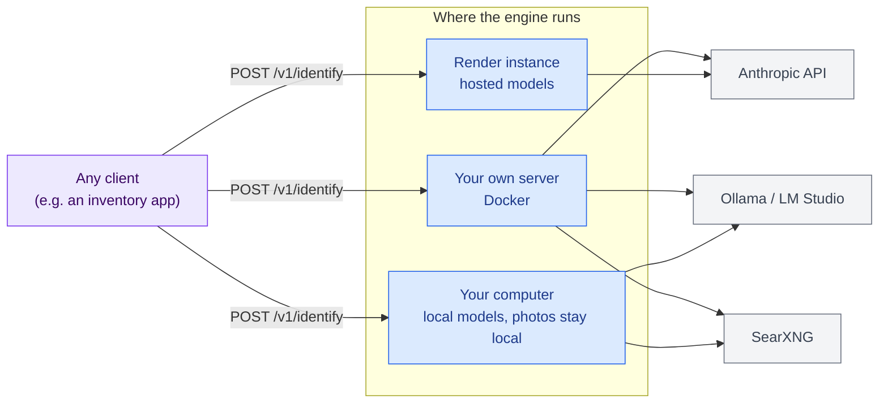
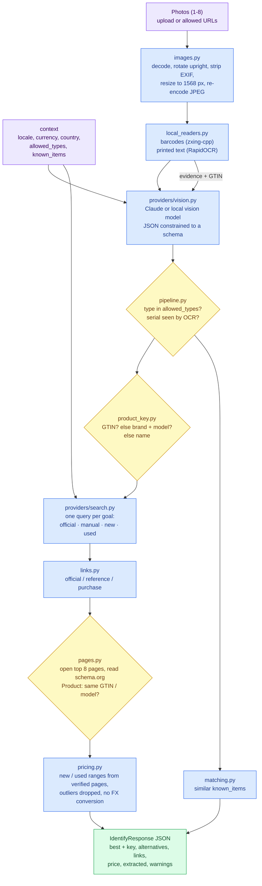
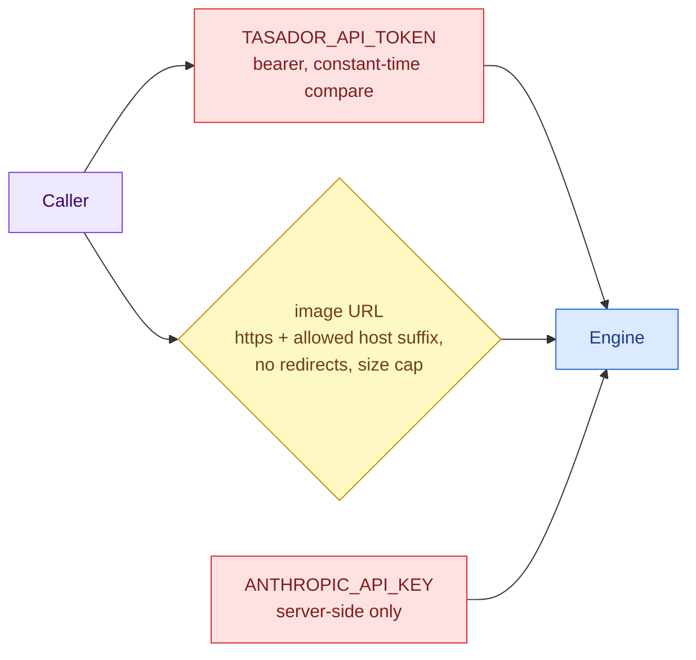

# Tasador architecture

Start here. This page shows Tasador's parts, how a photo becomes a JSON answer, and where each piece can run.

## Color palette

| Color | Meaning |
| :--- | :--- |
| 🟦 Blue | Our code: the engine and its stages |
| 🟪 Purple | Inputs: photos and the caller's context |
| 🟨 Yellow | Checks and decisions |
| 🟩 Green | Outputs: the JSON response |
| ⬜ Grey | External systems we do not own (model APIs, search engines, shops) |
| 🟥 Red | Credentials (API keys, bearer token) |

## The big picture

Tasador is an **appraiser** ("tasador" in Spanish). You send it photos of a physical item; it answers with what the item is (name, brand, model, type, serial number) and what it costs new and used, with the shop pages it found. It does not store anything and knows nothing about the app calling it: an inventory app passes its own vocabulary (allowed types, currency, items it already owns) in the request.

The same engine runs in three places, and callers only change the URL:

## From photos to JSON

One request runs through four stages. Each stage is optional: a stage that is not configured, or fails, adds a line to `warnings` and the response carries what the other stages found. A request never fails because a provider is down.

Why this order:

- **Local readers first.** A barcode or nameplate often gives the exact model and serial number with no model call. Their output goes to the vision model as evidence, so it reads "DJM-900NXS2" from the label instead of guessing from the shape.
- **The vision model's answer is constrained.** On Claude, structured outputs force the JSON schema and `type` is an enum built from the caller's `allowed_types`. Local models get the schema in the prompt and the reply is validated. Either way `pipeline.py` re-checks the result.
- **Search by identifier, like price comparison sites.** The product key (barcode number, else brand + model) drives one search per goal, so official pages and manuals come back alongside shops. See [RESEARCH.md](RESEARCH.md) for how others do it.
- **Guesses are flagged, not trusted.** A serial number the model reports but OCR never read gets `serial:unconfirmed` in `evidence`. Claude search hits whose URL never appeared in the real search results are dropped. Every shop and maker page that is opened is marked with how it matched (`verified: gtin / model / unconfirmed / unchecked`).
- **Exact prices come from the page, not the snippet.** Shops embed schema.org `Product`/`Offer` data for search engines; `pages.py` reads it (price, currency, condition, stock, GTIN, model number) without any model.
- **Prices are ranges with sources, never one number.** Only listings in the requested currency count toward a range, currencies are not converted, and with 4 or more prices the outliers are dropped (a "case only" listing at 99 PLN).

## Providers

| Stage | Provider | Selected by | Needs |
| :--- | :--- | :--- | :--- |
| Vision | `AnthropicVision` | `TASADOR_VISION_PROVIDER=anthropic` | `ANTHROPIC_API_KEY` |
| Vision | `OpenAICompatibleVision` | `TASADOR_VISION_PROVIDER=openai`, `gemini`, `openrouter`, `groq`, `mistral`, `together`, `xai`, `ollama`, `lmstudio`, or `openai-compatible` | `TASADOR_VISION_MODEL`, `TASADOR_VISION_API_KEY` (cloud), `TASADOR_VISION_BASE_URL` (servers without a preset) |
| Web search | `BraveSearch` | `TASADOR_SEARCH_PROVIDER=brave` | `TASADOR_SEARCH_API_KEY` |
| Web search | `AnthropicWebSearch` | `TASADOR_SEARCH_PROVIDER=anthropic` | `ANTHROPIC_API_KEY` |
| Web search | `SearxngSearch` | `TASADOR_SEARCH_PROVIDER=searxng` | `TASADOR_SEARXNG_URL`, JSON format on |
| Barcodes | zxing-cpp | `barcode` extra installed | nothing |
| Printed text | RapidOCR (ONNX) | `ocr` extra installed | ~450 MB RAM |

`auto` (the default) picks Anthropic when a key is set, otherwise the local options that have a URL, otherwise none. `GET /v1/capabilities` reports what a running copy actually has.

## Security

- Image URLs are off until `TASADOR_ALLOWED_IMAGE_HOSTS` lists host suffixes. Only https, no redirects (a redirect could point inside your network) and a size cap.
- Photos are re-encoded before anything else sees them, which drops EXIF metadata such as GPS position.
- Opening result pages (`pages.py`): at most `TASADOR_VERIFY_PAGES` (8) per request, 4 at a time, robots.txt respected, a clear `TasadorBot` user agent, 3 MB cap, HTML only, and private / local addresses refused on every redirect hop.
- Nothing is stored. In local mode the photos never leave the machine; only text search queries do.
