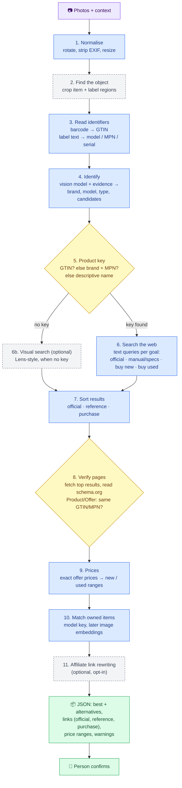

# How others do it: state of the art and Tasador's pipeline

Research from November 2026 on how companies turn a photo into "what is it, where to read about it, where to buy it, what it costs", and what Tasador takes from each. Colors follow [ARCHITECTURE.md](ARCHITECTURE.md#color-palette).

## Four families of systems

| Family | Who | How it works | What it needs | Lesson for Tasador |
| :--- | :--- | :--- | :--- | :--- |
| **Catalog visual search** | Amazon Lens, Pinterest Lens, eBay image search | Find the object in the photo, crop it, turn the crop into an embedding (a vector), find the nearest products in **their own catalog** (approximate nearest neighbour search), re-rank | A catalog of millions of products with photos | We have no catalog of the world. Useful for one part only: matching against the caller's own items |
| **Web visual search** | Google Lens | Same idea, but the index is the whole web plus Google Shopping. Results include store listings and prices where available | Google's index. No official public API; third-party wrappers (SerpApi, Apify, OpenWebNinja) resell it | Best for items with no readable label. Usable as an optional paid provider, not as the core |
| **Price comparison** | Google Shopping, Idealo, Ceneo, PriceRunner | Not image-based. Merchants send product feeds; offers are grouped by identifier: **GTIN (barcode) first, then brand + MPN (model number)**, then attributes. Bundles and multipacks are the classic false match | Merchant feeds or affiliate networks | The key to prices is a **product identifier**, not a picture. Once we know GTIN or brand + model, finding offers is a text problem |
| **Photo-to-listing** | eBay Magical Listing, other resale apps | A multimodal model writes title, category and item specifics from photos; price is suggested from comparable listings; the seller reviews before publishing | A vision model + sold-listing data | Same shape as Tasador. eBay's tool was reported to misidentify items at the first step, so **a person confirms**, and identification must be checkable |

Research frontier (2025-2026): **multimodal search agents** such as DeepMMSearch-R1 let a vision model plan several searches, crop the relevant region before an image search (cropping cuts background noise), and refine queries from what it finds. That is the direction Tasador's Claude provider already leans toward, and the cropping step is worth copying for local models.

## Where links and prices can come from

| Source | Gives | Access | Verdict |
| :--- | :--- | :--- | :--- |
| Search engine (SearXNG self-hosted, Claude web search, Brave/Bing-style APIs) | Official pages, manuals, reviews, shop pages | Free (SearXNG) or per request | **Core.** Works everywhere |
| **schema.org `Product`/`Offer` data inside shop pages** | Exact price, currency, availability, condition, GTIN, MPN | Fetch the page; most shops embed it as JSON-LD for Google Shopping | **Core.** Exact prices and a way to verify the page is the same product, without any model |
| Barcode / GTIN databases (GS1, UPC lookups) | Canonical name and brand from a barcode | Free tiers, keys | Optional, when a barcode is read |
| Google Lens wrappers (SerpApi etc.) | Visual matches for items with no label | Paid, third-party, terms to check | Optional provider |
| Allegro API | Polish offers | `GET /offers/listing` is limited to **verified applications** | Later, after applying for verification |
| Amazon | Offers + affiliate links | PA-API 5 is retired; the **Creators API** needs an approved Associates account with recent sales | Only with an affiliate account |
| Affiliate networks (Awin, Ceneo partner programs...) | "Referral" links that pay a commission | Per-network accounts | A link rewriter at the end of the pipeline, opt-in |

## Tasador's pipeline (target)

🟪 input · 🟦 built or in progress · 🟨 decision / verification · 🟩 output · ⬜ dashed: planned, optional

### Status

| Step | Status |
| :--- | :--- |
| 1. Normalise, 3. Read identifiers, 4. Identify | ✅ built |
| 5. Product key (GTIN > brand + model > name) | ✅ built (`product_key.py`) |
| 6. One search per goal, per language | ✅ built (`product_key.goal_queries`, both search providers) |
| 7. Sort into official / reference / purchase | ✅ built (`links.py`) |
| 8. Verify pages with schema.org data | ✅ built (`pages.py`) |
| 9. Prices from verified pages | ✅ built (`price.verified_only`) |
| 10. Match owned items | ✅ by model text; image embeddings planned |
| 2. Crop item and label | ⬜ planned |
| 6b. Visual search for items without a label | ⬜ planned, optional paid provider |
| 11. Affiliate link rewriting | ⬜ planned, opt-in |

Everything in steps 1-10 runs locally and free (Ollama + SearXNG + page fetches). Claude, Lens wrappers and affiliate APIs plug in as optional providers.

## Sources

- Google Lens, how it works: <https://lens.google/howlensworks/>; shopping with Lens: <https://blog.google/products-and-platforms/products/shopping/visual-search-lens-shopping/>
- Amazon Lens Live (visual embedding model over the catalog): <https://chainstoreage.com/amazon-introduces-lens-live-ai-powered-visual-shopping-tool>; AWS visual search reference: <https://aws.amazon.com/blogs/machine-learning/visual-search-on-aws-part-1-engine-implementation-with-amazon-sagemaker>
- Visual Search at eBay (KDD 2017): <https://arxiv.org/abs/1706.03154>; eProduct benchmark: <https://arxiv.org/abs/2107.05856>
- Learning a Unified Embedding for Visual Search at Pinterest (KDD 2019): <https://arxiv.org/abs/1908.01707>
- eBay Magical Listing: <https://innovation.ebayinc.com/tech/features/magical-listing-tool-harnesses-the-power-of-ai-to-make-selling-on-ebay-faster-easier-and-more-accurate/>; 2025 update: <https://www.digitalcommerce360.com/2025/04/15/ebay-ai-aided-tool-cut-steps-create-listings/>; critical review: <https://www.valueaddedresource.net/ebay-main-street-touts-ai-for-small-business/>
- Product matching by identifiers: <https://blog.affiliate.com/product-feed-data-normalization/>, <https://groupbwt.com/blog/product-matching/>
- Google Lens API wrappers: <https://serpapi.com/blog/how-google-replaced-search-by-image-with-google-lens/>, <https://apify.com/johnvc/google-lens-api>
- Marqo e-commerce embeddings (open models, beat SigLIP on product retrieval): <https://marqo.ai/blog/introducing-marqos-ecommerce-embedding-models>
- DeepMMSearch-R1 (multimodal search agent with region cropping): <https://arxiv.org/abs/2510.12801>
- Allegro offers listing, verified apps only: <https://developer.allegro.pl/docs/offers-listing>
- Amazon PA-API 5 deprecation → Creators API: <https://affiliate-program.amazon.com/creatorsapi/docs/en-us/paapiv5-deprecation>
